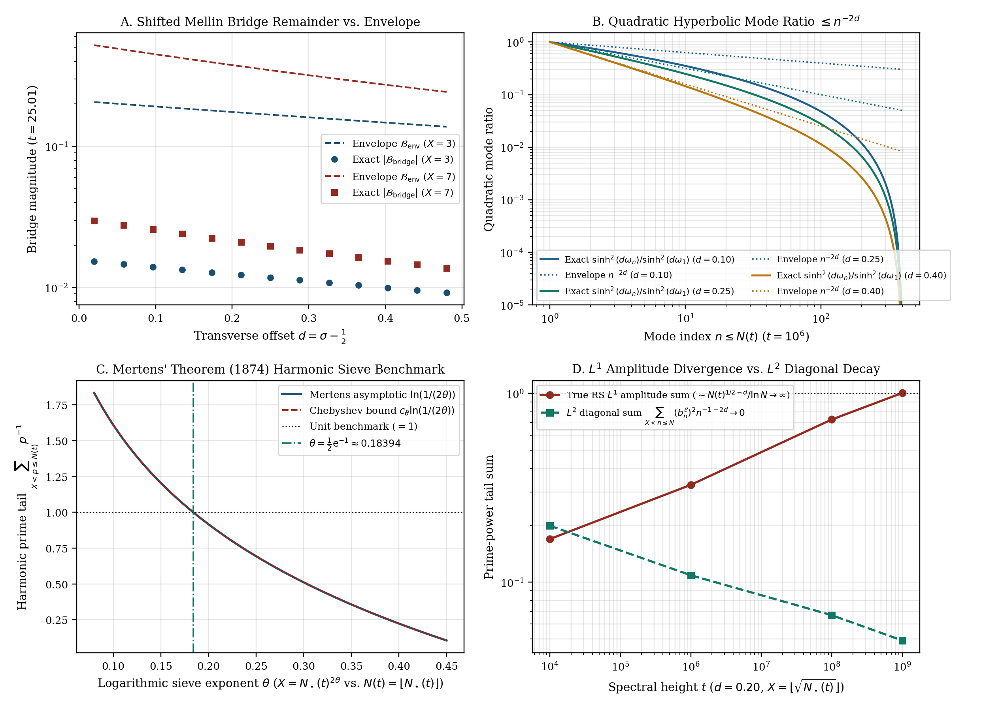
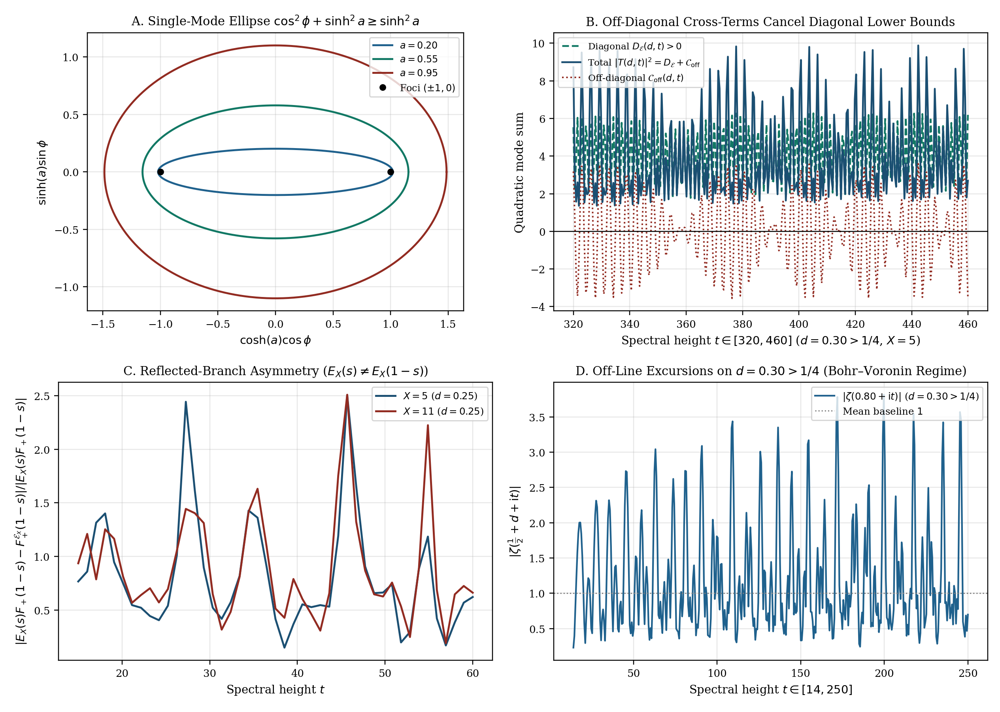

# Shifted Mellin Bridge Decomposition, Diagonal Stieltjes Tail Bounds, and Off-Diagonal Obstructions for Euler-Sieved Approximations to Riemann's Xi-Function

**Author:** Thijs Missiaen (Independent Researcher, Belgium · ORCID: [0009-0007-3678-0810](https://orcid.org/0009-0007-3678-0810))  
**DOI (Zenodo / CERN):** [](https://doi.org/10.5281/zenodo.23645891) [`10.5281/zenodo.23645891`](https://doi.org/10.5281/zenodo.23645891) (`v9.1.0`: [`10.5281/zenodo.24141070`](https://doi.org/10.5281/zenodo.24141070))  
**Manuscript:** [`paper/paper9_confocal_ellipse_synthesis.pdf`](paper/paper9_confocal_ellipse_synthesis.pdf) (AMS-LaTeX, 11 pages) · [`paper/paper9_confocal_ellipse_synthesis.tex`](paper/paper9_confocal_ellipse_synthesis.tex)  
**Verification Suite:** [`scripts/verify_paper9_confocal_ellipse_synthesis.py`](scripts/verify_paper9_confocal_ellipse_synthesis.py) (50-digit `mpmath`)  
**MSC 2020:** Primary `11M06`, `11M26`; Secondary `30D15`, `41A60`

## Overview

Let $\Xi(t - \mathrm{i}d) := \xi(\frac{1}{2} + d + \mathrm{i}t)$ denote Riemann's completed zeta function at $s = \frac{1}{2} + d + \mathrm{i}t$, with canonical transverse Wronskian

$$W(d, t) := \frac{1}{2}\frac{\partial}{\partial d}\lvert \Xi(t - \mathrm{i}d)\rvert^2 = 16\int_0^{\infty} y\sinh(2dy)\,I(y, t)\,\mathrm{d}y,$$

and let $E_X(s) := \prod _ {p \le X}(1 - p^{-s})$ be a finite Euler-sieve polynomial. This note separates the unconditional analytical identities and $L^2$ diagonal prime-tail bounds satisfied by $\Xi(t - \mathrm{i}d)E_X(s)$ from four structural obstructions explaining why shifted Mellin bridges and single-mode confocal-ellipse identities cannot establish off-critical zero-freeness in the critical strip.

## Unconditional Identities and Diagonal Bounds

1. **Riemann-Type Shifted Mellin Three-Part Decomposition (Theorem 2.1).** Applying Riemann's (1859) classical symmetry-point integral split at $u = 0$ to the shifted Jacobi-theta kernel $\Phi _ {\mathcal{E}}(u)$ yields the exact identity

$$\frac{1}{2}\Xi(t - \mathrm{i}d)\,E_X(s) = \mathcal{I} _ +^{\mathcal{E}}(s) + E_X(s)\,F _ +(1 - s) + \mathcal{B} _ {\mathrm{bridge}}^{\mathcal{E}}(s),$$

where $\mathcal{I} _ +^{\mathcal{E}}(s) = \sum _ {n \ge 1} b _ n^{\mathcal{E}}(X)\,\mathcal{J} _ n(s)$ is expressed in closed incomplete-Gamma shells $\mathcal{J} _ n(s)$ and $\lvert \mathcal{B} _ {\mathrm{bridge}}^{\mathcal{E}}(s)\rvert$ is bounded by a finite divisor sum of compact Gaussian integrals.

2. **Hyperbolic Mode Ratios, $L^2$ Stieltjes Tail Bounds, and Mertens' Benchmark (Theorem 3.1).** With $N _ {\star}(t) := \sqrt{t/(2\pi)}$ and $\omega _ n(t) := \ln(N _ {\star}(t)/n)$, the hyperbolic mode ratios satisfy $\sinh^2(\frac{1}{2}d\omega _ n)/\sinh^2(\frac{1}{2}d\omega _ 1) \le n^{-d}$ and $\sinh^2(d\omega _ n)/\sinh^2(d\omega _ 1) \le n^{-2d}$. On $X \ge \sqrt{N(t)}$, every surviving integer $n \in (\lfloor X\rfloor, N(t)]$ with $b _ n^{\mathcal{E}}(X) \neq 0$ is strictly a prime $p \in (X, N(t)]$, and Rosser–Schoenfeld's (1962) explicit Chebyshev bound yields the unconditional Stieltjes upper bound $B _ {\mathrm{primes}}(d, t; X)$ for $\sum _ {X < p \le N(t)} p^{-1-2d}$. In the $d \to 0^+$ harmonic limit along $X = (t/(2\pi))^{\theta}$, Mertens' second theorem (1874) gives $\sum _ {X < p \le N(t)} p^{-1} = \ln(1/(2\theta)) + o(1)$, crossing unity at $\theta _ {\mathrm{Mertens}} = \frac{1}{2}\mathrm{e}^{-1} \approx 0.18394$.



3. **Elementary Single-Mode Trigonometric-Hyperbolic Identity (Proposition 4.1).** Each individual symmetric mode $T _ n(d, t) = 2n^{-1/2}[\cosh(d\omega _ n)\cos\phi _ n + \mathrm{i}\sinh(d\omega _ n)\sin\phi _ n]$ satisfies the elementary algebraic relation

$$\cosh^2(d\omega _ n)\cos^2\phi _ n + \sinh^2(d\omega _ n)\sin^2\phi _ n = \cos^2\phi _ n + \sinh^2(d\omega _ n).$$

## Structural Obstructions to Off-Critical Closure

1. **Reflected-Branch Asymmetry (Proposition 2.3).** Because $E _ X(s) \neq E _ X(1 - s)$ satisfies no functional equation, the reflected branch in Theorem 2.1 is $E _ X(s)F _ +(1 - s)$ rather than the symmetrically sieved sum $F _ +^{\mathcal{E}}(1 - s)$, producing an $\mathcal{O}(1)$ mismatch whenever symmetric Riemann–Siegel mode sums are used as proxies for $\Xi E _ X$.
2. **Divergence of the True $n^{-1/2}$-Weighted $L^1$ Sum (Proposition 3.2).** Under the true Riemann–Siegel amplitude $n^{-1/2}$, the $L^1$ prime sum weighted by $\sinh^2(\frac{1}{2}d\omega _ n)/\sinh^2(\frac{1}{2}d\omega _ 1)$ scales as $\sum _ {X < p \le N(t)} p^{-(1/2+d)} \asymp \frac{N(t)^{1/2-d}}{(1/2-d)\ln N(t)} \to +\infty$ for every $0 < d < \frac{1}{2}$. Replacing $n^{-1/2}$ by $n^{-(1-d)}$ to obtain a harmonic sum is analytically invalid.
3. **Homogeneity Mismatch and Off-Diagonal Cancellation (Proposition 4.3(i)–(ii)).** Multiplying linear $n^{-1/2}$ by quadratic $\sinh^2(d\omega _ n)$ mixes $L^1$ amplitudes with $L^2$ energies; in the genuine quadratic norm $\lvert T(d, t)\rvert^2 = D _ {\mathcal{E}}(d, t) + \mathcal{C} _ {\mathrm{off}}(d, t)$, destructive off-diagonal cross-terms cancel 89.9% of $D _ {\mathcal{E}}(d, t)$ already at $(d, X, t) = (0.30, 5, 1096.30)$.
4. **Bohr Density and Voronin Universality on $d > \frac{1}{4}$ (Proposition 4.3(iii)).** By Bohr–Landau (1914) and Voronin's universality theorem (1975), $\inf _ {t > 0}\lvert \zeta(\sigma + \mathrm{i}t)E _ X(\sigma + \mathrm{i}t)\rvert = 0$ for every fixed $\sigma \in (\frac{1}{2}, 1)$, ruling out any uniform positive lower bound on $\frac{1}{4} < d < \frac{1}{2}$.



## Repository Structure and Reproducibility

- [`paper/paper9_confocal_ellipse_synthesis.tex`](paper/paper9_confocal_ellipse_synthesis.tex) and [`paper/paper9_confocal_ellipse_synthesis.pdf`](paper/paper9_confocal_ellipse_synthesis.pdf) – AMS-LaTeX source and compiled 11-page PDF.
- [`scripts/verify_paper9_confocal_ellipse_synthesis.py`](scripts/verify_paper9_confocal_ellipse_synthesis.py) – 50-decimal `mpmath` verification suite and figure generator.
- [`figures/`](figures/) – Vector PDF and PNG figures illustrating the bridge bounds, $L^2$ vs. $L^1$ behavior, off-diagonal cancellation, and Bohr–Voronin excursions.
- [`.agents/skills/confocal-ellipse-bridge-synthesis/SKILL.md`](.agents/skills/confocal-ellipse-bridge-synthesis/SKILL.md) – Agent mathematical reference skill.

Run the full verification suite via:

```bash
python scripts/verify_paper9_confocal_ellipse_synthesis.py
```

## License and Citation

Released under the [MIT License](LICENSE). Metadata is provided in [`CITATION.cff`](CITATION.cff) and [`.zenodo.json`](.zenodo.json).
